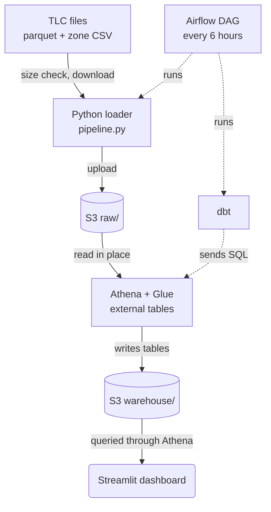

# NYC taxi pipeline

This project copies the public yellow taxi trip files of the NYC Taxi and
Limousine Commission (TLC) into S3. It builds analytics tables on them with dbt
(a tool that builds SQL models) and Athena (AWS's SQL engine for files in S3),
and shows the results in a Streamlit dashboard. Airflow runs the chain every 6
hours and loads new months as TLC publishes them.

You can load every month TLC has published without downloading a file twice,
query the raw parquet files in place, browse revenue, tips, airports, routes and
trends in a dashboard, and see which rows the pipeline dropped and which trips
look wrong but stayed in.

## Overview



Read it top to bottom. Solid arrows carry data. Dashed arrows are commands:
Airflow starts the loader and dbt, and dbt sends SQL to Athena. The loader
copies each monthly file to S3 and skips a file when S3 holds one of the same
size. Athena reads those files through Glue external tables (table definitions
that point at files in S3) and writes the dbt models to the warehouse prefix.
The dashboard queries those tables through Athena.

## Quick start

You need Python 3.12, `uv`, Docker, and an AWS profile named `nyc-taxi` with
access to the bucket, Glue and Athena. The IAM actions are listed in the
[runbook](docs/sop.md#iam-permissions).

Install, lint and test. This step needs no AWS access. The DAG tests are left
out because Airflow's pinned dependencies conflict with the project's, so CI runs
them in a separate job.

```bash
uv sync
uv run --group app pytest tests --ignore=tests/dags
uv run ruff check .
```

Create the Athena workgroup `nyc-taxi-dbt`, which caps each query at 5 GiB
scanned. Then load the zone lookup and one month into S3. Run these from the
repo root.

```bash
export AWS_PROFILE=nyc-taxi
uv run python dbt/scripts/create_workgroup.py
uv run python -m ingestion.pipeline --zones
uv run python -m ingestion.pipeline --service yellow --months 2024-01
```

Create the Glue tables and build the models. Run this from the repo root.

```bash
cd dbt
uv run --group dbt dbt run-operation create_raw_tables --profiles-dir . --target athena
uv run --group dbt dbt seed     --profiles-dir . --target athena
uv run --group dbt dbt snapshot --profiles-dir . --target athena
uv run --group dbt dbt build    --profiles-dir . --target athena
cd ..                       # back to the repo root
```

Start the dashboard from the repo root. It needs AWS access to the built tables.

```bash
uv run --group app streamlit run app/main.py
```

Run Airflow locally from the repo root. Compose refuses to start until `.env` sets
`POSTGRES_PASSWORD`, `AIRFLOW_ADMIN_PASSWORD`, `AIRFLOW__CORE__FERNET_KEY` and
`AIRFLOW__WEBSERVER__SECRET_KEY`.

```bash
cp .env.example .env        # then fill in the four values
mkdir -p .aws-airflow       # copy only the nyc-taxi profile from ~/.aws into it
docker compose up --build   # UI at http://localhost:8080
```

The Compose Streamlit service is commented out. Run the dashboard with `uv`.

The DAG `nyc_taxi_elt` starts paused. Unpause it in the UI, which listens on
`127.0.0.1` only. The [runbook](docs/sop.md) covers loading ranges, rebuilding a
month and fixing failed runs.

## What the dashboard shows

It has seven views. A view queries only when you select it. Each view prints
the megabytes Athena scanned. Overview prints it for its heatmap only.

- Overview: trips, revenue and average tip, daily revenue, top pickup zones, and an hour-by-weekday heatmap.
- Tips: tip percentage by hour and borough. TLC records tips for card payments only, so this covers cards.
- Airports: trips, revenue and average fare for JFK, LaGuardia and Newark.
- Routes: the busiest pickup-to-dropoff zone pairs and a borough-to-borough matrix.
- Efficiency: revenue per mile and per minute, by hour and borough.
- Trends: week-over-week change, and days whose revenue is far from normal for that weekday.
- Data quality: rows removed, suspect trips by reason, and example trips you can download as CSV.

The sidebar filters by borough and date. Tips and Efficiency also filter by hour,
payment type, vendor and weekday or weekend. Airports ignores the borough. Routes
and Data quality widen the dates to whole months, and Data quality ignores the
borough. Trends uses up to 112 days ending at the end date. The app rejects a
range over 400 days. Every 60 seconds it checks for a new dbt build and, if one
landed, clears its cache and reloads.

## Repo map

```
dags/nyc_taxi_elt.py    the Airflow DAG
ingestion/              TLC to S3 loader (pipeline.py; download.py and soda.py are local helpers)
dbt/
  models/staging/       stg_trips, stg_zones
  models/marts/         dim_zone, fct_trips, three marts, mart_month_quality,
                        dq_suspect_trips, mart_dq_summary (see docs/data-model.md)
  snapshots/, seeds/    dim_vendor (history table), vendors.csv
  macros/               create_raw_tables (Glue database and external tables)
  tests/                six singular tests
  scripts/              create_workgroup.py (Athena workgroup nyc-taxi-dbt)
app/                    Streamlit dashboard (main.py, views/, queries, loaders)
docker/, docker-compose.yml   Airflow and Streamlit images, local Airflow stack
tests/, notebooks/, .github/workflows/   Python tests, exploration notebook, CI
docs/                   architecture, data model, runbook, decision records
```

More docs: [docs/README.md](docs/README.md) lists every document in reading order:
[architecture](docs/architecture.md), [data model](docs/data-model.md),
[runbook](docs/sop.md) and the [decision records](docs/adr/).

## Known limitations

- Ingestion skips a file when the S3 size equals the TLC size. A republished file with the same size goes unnoticed ([ADR 0005](docs/adr/0005-idempotent-size-based-skip.md)).
- `trip_id` hashes six fields, so two real trips with identical values collapse into one row. Only 2024 is verified. Other years may fail on read.
- Vendor Helix (vendor 7, in the data from 2024-12) often records the same pickup and dropoff time, so its durations are wrong. Duration-based figures such as revenue per minute and average speed are off for those trips. Revenue and distance look usable. This was measured on 2024-01 to 2026-08, not taken from TLC documentation. See [the data model](docs/data-model.md#known-data-issue-helix-timestamps).
- Suspect trips stay in every dashboard number, including Efficiency. Nothing excludes them yet.
- About 1,500 of 5.9 million trips in 2024-01 and 2024-02 show 200 mph or more. A warn-level test reports them.
- Pull-request CI only parses dbt. The real `dbt build` runs after the merge to `main` ([ADR 0006](docs/adr/0006-ci-without-aws-secrets.md)).
- The vendor history (a slowly changing dimension of type 2, SCD2) was checked by hand once. No automated test covers it.
- In an early test with two months loaded (not measured again since), incremental `fct_trips`, which rewrites only the month you name, was no faster than a full refresh ([ADR 0007](docs/adr/0007-incremental-fct-trips-and-workgroup-cap.md)).
- The SQL uses Athena and Trino functions, so another warehouse needs code changes. There is one environment and no alerting beyond Airflow retries (3, with exponential backoff from 5 minutes).
- The bucket name and AWS profile are hard-coded defaults in `ingestion/pipeline.py`, `app/data.py`, `dbt/profiles.yml` and the `create_raw_tables` macro. Override them with environment variables: `S3_BUCKET` and `AWS_PROFILE` (loader and macro), `DBT_S3_STAGING_DIR`, `DBT_S3_DATA_DIR`, `DBT_SCHEMA` and `AWS_REGION` (dbt), and `ATHENA_OUTPUT`, `ATHENA_DATABASE`, `ATHENA_WORKGROUP` and `AWS_PROFILE` (dashboard).
