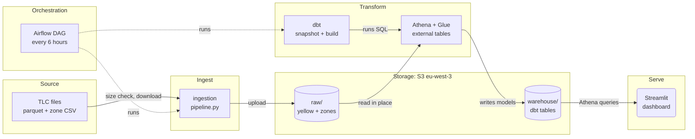

# NYC taxi pipeline

This project loads the public NYC TLC yellow taxi trip files into S3, builds
analytics tables with dbt on Athena, and shows them in a Streamlit dashboard.
Airflow runs the whole chain every 6 hours and picks up new months by itself.

You can:

- Load every month TLC has published, without downloading a file twice.
- Query the raw parquet files in place, with no database to run.
- Browse revenue, tips, airports, routes, efficiency and trends in a dashboard.
- See which rows the pipeline dropped and which trips look wrong but stayed in.

## How it fits together



Python copies each monthly file from TLC to S3 and skips files S3 already has.
Athena reads them through Glue external tables, and dbt builds the models on
top. The dashboard queries the finished tables through Athena.
Airflow starts the Python step and the dbt step (dashed lines).

## Quick start

You need Python 3.12, `uv`, Docker, and an AWS profile named `nyc-taxi` with
access to the bucket, Glue and Athena. The IAM actions are listed in
[docs/sop.md](docs/sop.md#iam-permissions).

Install, lint and test. No AWS access is needed for this step.

```bash
uv sync
uv run --group app pytest tests --ignore=tests/dags
uv run ruff check .
```

Load the zone lookup and one month into S3.

```bash
export AWS_PROFILE=nyc-taxi
uv run python -m ingestion.pipeline --zones
uv run python -m ingestion.pipeline --service yellow --months 2024-01
```

Create the Glue tables and build the models.

```bash
cd dbt
uv run --group dbt dbt run-operation create_raw_tables --profiles-dir . --target athena
uv run --group dbt dbt seed     --profiles-dir . --target athena
uv run --group dbt dbt snapshot --profiles-dir . --target athena
uv run --group dbt dbt build    --profiles-dir . --target athena
```

Start the dashboard. It needs AWS access to the built tables.

```bash
uv run --group app streamlit run app/main.py
```

Run Airflow locally. Compose refuses to start until `.env` has
`POSTGRES_PASSWORD`, `AIRFLOW_ADMIN_PASSWORD`, `AIRFLOW__CORE__FERNET_KEY` and
`AIRFLOW__WEBSERVER__SECRET_KEY`.

```bash
cp .env.example .env        # then fill in the four values above
mkdir -p .aws-airflow       # copy only the nyc-taxi profile from ~/.aws into it
docker compose up --build   # UI at http://localhost:8080
```

The DAG `nyc_taxi_elt` starts paused. Unpause it in the UI, which listens on
`127.0.0.1` only.

## What the dashboard shows

The dashboard has seven views. A view runs its queries only when you select
it, and it prints how many megabytes Athena scanned.

- Overview: trips, revenue and average tip, daily revenue, top pickup zones, and an hour-by-weekday heatmap.
- Tips: tip percentage by hour and by borough. TLC records tips for card payments only, so this covers cards.
- Airports: trips, revenue and average fare for JFK, LaGuardia and Newark.
- Routes: the busiest pickup-to-dropoff zone pairs and a borough-to-borough matrix.
- Efficiency: revenue per mile and per minute, by hour and by borough.
- Trends: week-over-week change and days whose revenue is far from the usual for that weekday.
- Data quality: rows removed, suspect trips by reason, example trips with a CSV download. See [docs/data-model.md](docs/data-model.md).

The sidebar filters by borough and dates. Tips and Efficiency also filter by
hour, payment type, vendor and weekday or weekend. The app checks the build time
of `mart_month_quality` every 60 seconds. When a new dbt build lands, it clears
its cache and reloads, so new months appear without a restart.

## Repo map

```
dags/nyc_taxi_elt.py    the Airflow DAG
ingestion/              TLC to S3 loader (pipeline.py is the one the DAG uses)
dbt/
  models/staging/       stg_trips, stg_zones
  models/marts/         dim_zone, fct_trips, marts, data-quality tables
  snapshots/            dim_vendor (SCD2)
  seeds/                vendors.csv
  macros/               create_raw_tables (Glue database and external tables)
  tests/                six singular tests
  scripts/              create_workgroup.py (Athena workgroup nyc-taxi-dbt)
  profiles.yml          Athena targets, no secrets
app/                    Streamlit dashboard (main.py, views/, queries, loaders)
docker/, docker-compose.yml   Airflow and Streamlit images, local Airflow stack
tests/, notebooks/      Python tests, exploration notebook
.github/workflows/      ci.yml, dbt-build.yml
docs/                   architecture, data model, runbook, decision records
```

`ingestion/download.py` and `ingestion/soda.py` write to local `data/raw` and
are not part of the DAG.

## Where to read more

[docs/README.md](docs/README.md) lists every document in reading order. In
short: [architecture](docs/architecture.md) for how data moves,
[data model](docs/data-model.md) for every dbt model and test,
[runbook](docs/sop.md) for commands, and [decisions](docs/adr/) for why.

## Known limitations

- Ingestion skips a file when the S3 size equals the TLC size. A republished file with the same size is not detected ([ADR 0005](docs/adr/0005-idempotent-size-based-skip.md)).
- `trip_id` hashes six fields. Two real trips with identical values collapse into one row.
- Only 2024 is verified. Parquet column types in other years may fail on read. Vendor 7 passes the tests but is unverified.
- Suspect trips stay in every dashboard number, including the Efficiency view. Nothing excludes them yet.
- `avg_speed_mph` is 200 or more on about 1,500 of 5.9 million trips in 2024-01 and 2024-02. A warn-level test reports them.
- Pull-request CI only parses dbt. The real `dbt build` runs after the merge to `main` ([ADR 0006](docs/adr/0006-ci-without-aws-secrets.md)).
- The vendor history (SCD2) was checked by hand once. No automated test covers it.
- At two months of data, incremental `fct_trips` is no faster than a full refresh ([ADR 0007](docs/adr/0007-incremental-fct-trips-and-workgroup-cap.md)).
- The SQL uses Athena and Trino functions, so another warehouse needs code changes.
- One environment, and no alerting beyond Airflow retries (3, with exponential backoff from 5 minutes).
- The bucket name and profile are defaults in `ingestion/pipeline.py`, `app/data.py`, `dbt/profiles.yml` and the `create_raw_tables` macro. Override them with `S3_BUCKET`, `AWS_PROFILE`, `DBT_S3_STAGING_DIR` and `DBT_S3_DATA_DIR`.
