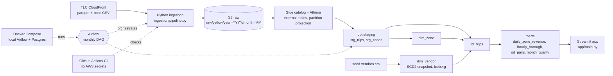

# NYC Taxi ELT

Batch ELT pipeline for NYC TLC yellow taxi trip data. Python loads monthly
parquet files into S3, Athena reads them in place through Glue external tables,
dbt-athena builds the models, Airflow runs the monthly sequence, and a
Streamlit app (`app/`) reads the mart.

## Architecture



Airflow task order (`dags/nyc_taxi_elt.py`):
`ingest_zones >> ingest_trips >> dbt_prepare >> dbt_snapshot >> dbt_build`.

- `dbt_prepare` runs `dbt run-operation create_raw_tables` and `dbt seed` (both idempotent).
- Schedule `@monthly`, `start_date` 2024-01-01, `catchup=False`. The run for logical date D processes the month of `data_interval_start`; `min_year`/`max_year` are set to that run's year.
- `dbt_build` is incremental by month: `--select stg_zones+ stg_trips+` with `run_month` set to the month.
- `ingest_trips` passes `--skip-unpublished` and the task uses `skip_on_exit_code=99`. A month TLC has not published yet (CloudFront returns 403) is skipped, and downstream tasks are skipped too.

## Stack

| Layer | Tool |
|---|---|
| Source | TLC public files on CloudFront (`d37ci6vzurychx.cloudfront.net`) |
| Ingestion | Python 3.12, requests, boto3, pyarrow, tenacity |
| Storage | S3, region `eu-west-3` |
| Query | Athena over Glue external tables (partition projection on year, month) |
| Transform | dbt-core 1.12.6, dbt-athena 1.11.1 |
| Orchestration | Airflow 2.10.5, LocalExecutor, Postgres 16.4 |
| CI | GitHub Actions (ruff, pytest, DAG import tests, dbt parse) |
| BI | Streamlit (`app/`; compose service commented out) |

## Quickstart

Prerequisites: Python 3.12, `uv`, Docker, an AWS profile named `nyc-taxi`
with access to the bucket, Glue and Athena. Required IAM actions are listed in
`docs/sop.md`.

```bash
# 1. Python deps and tests (no AWS needed)
uv sync
uv run --group app pytest tests --ignore=tests/dags
uv run ruff check .

# 2. Load one month into S3
export AWS_PROFILE=nyc-taxi
uv run python -m ingestion.pipeline --zones
uv run python -m ingestion.pipeline --service yellow --months 2024-01

# 3. Create Glue tables, then build models (from dbt/)
cd dbt
uv run --group dbt dbt run-operation create_raw_tables --profiles-dir . --target athena
uv run --group dbt dbt seed     --profiles-dir . --target athena
uv run --group dbt dbt snapshot --profiles-dir . --target athena
uv run --group dbt dbt build    --profiles-dir . --target athena
```

`tests/dags` needs Apache Airflow, which conflicts with the project's
`requests` pin, so CI runs it in a separate job (see CI below).

Streamlit app (needs AWS access to the mart):

```bash
uv run --group app streamlit run app/main.py
```

It shows KPI tiles, daily revenue, top pickup zones and an hour/weekday heatmap.
Queries filter on the `pickup_month` partition so Athena prunes partitions, and
errors are shown as generic messages. The compose service is commented out.

Local Airflow:

```bash
cp .env.example .env
# set POSTGRES_PASSWORD, AIRFLOW_ADMIN_PASSWORD, AIRFLOW__CORE__FERNET_KEY,
# AIRFLOW__WEBSERVER__SECRET_KEY
docker compose up --build   # UI at http://localhost:8080
```

The DAG `nyc_taxi_elt` is created paused. The Airflow UI binds to
`127.0.0.1:8080` only. Compose mounts `./ingestion`, `./dbt` (both read-only)
and `./pyproject.toml` into `/opt/project`, and `./.aws-airflow` (gitignored,
only the `nyc-taxi` profile copied from `~/.aws`) at `/home/airflow/.aws`.
`AWS_PROFILE` is fixed to `nyc-taxi` in the containers. Compose fails at
startup if `POSTGRES_PASSWORD`, `AIRFLOW_ADMIN_PASSWORD`, the Fernet key or the
webserver secret key is unset.

## Repo layout

```
ingestion/
  pipeline.py   TLC -> S3 loader used by the DAG (idempotent, retries, schema check, exit 99 for unpublished months)
  download.py   local download of TLC files to data/raw (also provides trip_url)
  soda.py       local pull from the NYC Open Data SODA API to data/raw/soda
dbt/
  models/staging/   stg_trips, stg_zones
  models/marts/     dim_zone, fct_trips, mart_daily_zone_revenue
  snapshots/        dim_vendor (SCD2, Iceberg)
  seeds/            vendors.csv
  macros/           create_raw_tables (Glue database + external tables)
  tests/            assert_dropoff_after_pickup.sql, assert_plausible_speed.sql (warn)
  scripts/          create_workgroup.py (Athena workgroup nyc-taxi-dbt)
  profiles.yml      Athena target, no secrets
dags/nyc_taxi_elt.py
app/                Streamlit app (main.py, data.py)
docker/             airflow.Dockerfile, streamlit.Dockerfile
docker-compose.yml  postgres, airflow-init, webserver, scheduler
tests/              ingestion, app and DAG import tests
notebooks/          exploration notebook
.github/workflows/ci.yml
docs/               architecture.md, sop.md, adr/
```

## Data model

| Model | Type | Notes |
|---|---|---|
| `stg_trips` | view | Casts and renames; drops invalid rows; `trip_id` is an md5 of vendor, pickup, dropoff, zones, total; dedups on `trip_id` |
| `stg_zones` | view | Zone lookup CSV with typed `zone_id` |
| `dim_zone` | table (hive, parquet) | Zones from `stg_zones` |
| `dim_vendor` | snapshot (Iceberg) | SCD2, `check` strategy on `vendor_name`, source is the `vendors` seed |
| `fct_trips` | incremental (hive, parquet, `insert_overwrite`, partitioned by `pickup_month`) | One row per trip; joins zones and the current vendor row (`dbt_valid_to is null`); adds duration, speed, tip percent, payment name |
| `mart_daily_zone_revenue` | table (hive, parquet) | Trips and revenue per pickup zone per day |

Cost control: `min_year` and `max_year` vars (both 2024 in
`dbt_project.yml`) restrict which partitions staging scans. Override with
`--vars '{min_year: 2023, max_year: 2024}'`; the DAG sets both to the run year.
dbt runs in Athena workgroup `nyc-taxi-dbt`, which has an enforced 5 GiB
per-query scan cap (ADR 0007; `dbt/scripts/create_workgroup.py` creates it).

## Data quality

dbt tests (`data_tests` in the yml files):

- `stg_zones.zone_id`: not_null, unique.
- `stg_trips.trip_id`: not_null, unique. `vendor_id`: not_null, accepted values 1, 2, 6, 7. `payment_type`: accepted values 0 to 6. `pickup_at`: not_null.
- `dim_zone.zone_id`: not_null, unique.
- `fct_trips.trip_id`: not_null, unique. `vendor_id` and `pickup_zone_id`: not_null and relationships to `dim_vendor` and `dim_zone`. `dropoff_zone_id`: relationships to `dim_zone`. `payment_type`: accepted values. `trip_duration_min`: not_null.
- `mart_daily_zone_revenue.pickup_date`: not_null.
- `dim_vendor.vendor_id` and `vendor_name`: not_null.
- Singular test `assert_dropoff_after_pickup`: no `fct_trips` row with dropoff before pickup.
- Singular test `assert_plausible_speed` (severity `warn`): `avg_speed_mph` of 200 or more is reported, not blocking.

Row filters in `stg_trips` (rows removed, not flagged): null pickup, dropoff
before pickup, duration of 24 hours or more, negative distance or total, and
pickup outside the file's own year and month.

Ingestion checks: a downloaded trip file must contain 10 required columns
(read from the parquet footer) before upload.

Python tests: `tests/ingestion`, `tests/app` and `tests/dags`. Counts change; see CI output or count with `grep -c '^def test_' -r tests`.

## CI

`.github/workflows/ci.yml` runs on pull requests with no AWS credentials:

- `lint-test`: `ruff check .` and pytest excluding `tests/dags`.
- `dag-tests`: installs Airflow 2.10.5 with its constraint file and runs `tests/dags`.
- `dbt-parse`: `dbt deps` and `dbt parse` only. Models are never compiled or run against Athena in CI.

## Known limitations

- Idempotency is size-only: ingestion skips a file when the S3 object size equals the source `Content-Length`. Changed content with the same size is not detected (ADR 0005).
- `trip_id` is a hash of six fields. Two real trips with identical values collapse into one row.
- Only 2024 is verified. Parquet column types of other years are untested and may fail on read (see the `create_raw_tables` macro).
- Vendor 7 is accepted in tests but unverified.
- Incremental `fct_trips` is not yet faster than a full refresh at two months of data: 55 to 61 s and 49 + 145 MB scanned versus 54.8 s and 97 MB for full refresh (ADR 0007). Break-even is expected later and was not measured.
- `avg_speed_mph` has 1502 implausible rows (200 mph or more). They are flagged by the warn-severity test `assert_plausible_speed`, not removed.
- CI is parse-only for dbt (`dbt parse`) and has never run on GitHub. Model SQL and data tests are verified only by manual runs against AWS.
- SCD2 (`dim_vendor` snapshot) was checked by hand once: renaming vendor 2 in the seed and re-running `dbt snapshot` closed the old row and opened a new one. There is no automated test for it.
- The models use Athena/Trino functions (`date_diff`, `to_hex`, `md5(to_utf8(...))`, `day_of_week`) and hive/Iceberg `table_type` configs, so moving to another warehouse needs code changes, not only a new profile.
- The Streamlit compose service is commented out; run the app with `uv run`.
- Single environment, no staging/prod split, no alerting beyond Airflow retries (3 retries, exponential backoff, 5 minute delay).
- `download.py` and `soda.py` write to local `data/raw` and are not part of the DAG.
- Default bucket name and profile are hard-coded in `ingestion/pipeline.py`, `app/data.py`, `dbt/profiles.yml` and the `create_raw_tables` macro; override with `S3_BUCKET`, `AWS_PROFILE`, `DBT_S3_STAGING_DIR`, `DBT_S3_DATA_DIR`.
