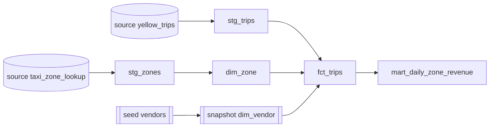
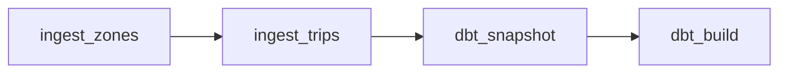

# Architecture

## Data flow

1. Source: TLC files at `https://d37ci6vzurychx.cloudfront.net/trip-data/<service>_tripdata_<YYYY-MM>.parquet` and `misc/taxi_zone_lookup.csv`.
2. Ingestion (`ingestion/pipeline.py`): HEAD the source, compare with the S3 object size, download to a temp file if needed, check required columns in the parquet footer, upload.
3. Raw zone in S3:
   - `raw/yellow/year=YYYY/month=MM/yellow_tripdata_YYYY-MM.parquet`
   - `raw/zones/taxi_zone_lookup.csv`
4. Glue database `nyc_taxi_raw`, created by the dbt macro `create_raw_tables`:
   - `yellow_trips`: external parquet table, partitioned by `year`, `month`, partition projection enabled (year 2009 to 2030, month 1 to 12).
   - `taxi_zone_lookup`: external CSV table (OpenCSVSerde, header skipped).
5. dbt-athena writes to schema `nyc_taxi_dbt`, data under `s3://<bucket>/warehouse/`, query output under `athena-results/`.
6. Consumer: Streamlit reads `mart_daily_zone_revenue`. Not present in this branch.

## dbt lineage

## Materializations

| Path | Materialization |
|---|---|
| `models/staging` | view |
| `models/marts` | table, `table_type: hive`, `format: parquet` |
| `snapshots/dim_vendor` | Iceberg table (required by dbt-athena snapshots) |
| `seeds` | hive table |

## Orchestration

DAG `nyc_taxi_elt`, schedule `@monthly`, `start_date` 2025-01-01, `catchup=True`, `max_active_runs=1`.

- Tasks are `BashOperator` calls with working directory `/opt/project`.
- Python and dbt run from `/opt/venv`, separate from Airflow's own environment, to avoid dependency conflicts.
- The month is passed as `{{ data_interval_start.strftime('%Y-%m') }}` to `ingestion.pipeline --months`.
- `dbt_snapshot` runs `dbt deps` then `dbt snapshot`. `dbt_build` runs `dbt build` (seeds, models, tests) over the whole configured year range.
- Defaults: owner `data-eng`, 3 retries, 5 minute delay, exponential backoff.

## Local runtime (Docker Compose)

Services: `postgres` (16.4), `airflow-init` (db migrate, admin user), `airflow-webserver` (port 8080), `airflow-scheduler`. Executor is `LocalExecutor`. Mounts: `./dags` read-only, the repo at `/opt/project`, `~/.aws` read-only. The Streamlit service is commented out.

## CI

Three jobs on pull requests, no secrets: lint plus unit tests, DAG import tests, `dbt parse`. See ADR 0006.

## Design notes and constraints

- `trip_id` is md5 of vendor, pickup, dropoff, pickup zone, dropoff zone, total amount. `stg_trips` keeps one row per `trip_id`.
- `stg_trips` row filters are in the model SQL; filtered rows are dropped, not stored.
- `fct_trips` is a left join, so trips with unknown zones keep a null borough/zone name. Tests require non-null `pickup_zone_id`, and `relationships` tests check zone and vendor keys.
- Cost and schema risk are bounded by the `min_year`/`max_year` vars.

## Decisions

- [0001 S3 over GCS](adr/0001-s3-over-gcs.md)
- [0002 Athena and dbt-athena over Snowflake](adr/0002-athena-dbt-over-snowflake.md)
- [0003 dbt snapshot for SCD2](adr/0003-dbt-snapshot-scd2.md)
- [0004 Streamlit over Tableau](adr/0004-streamlit-over-tableau.md)
- [0005 Idempotent size-based ingestion skip](adr/0005-idempotent-size-based-skip.md)
- [0006 CI without AWS secrets](adr/0006-ci-without-aws-secrets.md)
