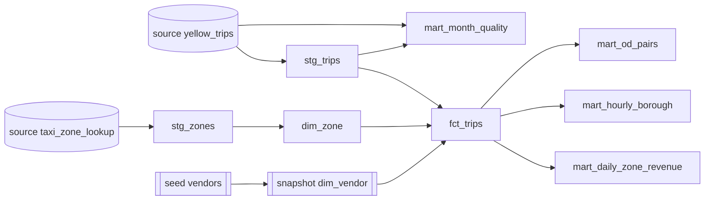
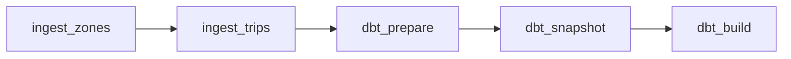

# Architecture

## Data flow

1. Source: TLC files at `https://d37ci6vzurychx.cloudfront.net/trip-data/<service>_tripdata_<YYYY-MM>.parquet` and `misc/taxi_zone_lookup.csv`.
2. Ingestion (`ingestion/pipeline.py`): HEAD the source, compare with the S3 object size, download to a temp file if needed, check required columns in the parquet footer, upload.
3. Raw zone in S3:
   - `raw/yellow/year=YYYY/month=MM/yellow_tripdata_YYYY-MM.parquet`
   - `raw/zones/taxi_zone_lookup.csv`
4. Glue database `nyc_taxi_raw`, created by the dbt macro `create_raw_tables`:
   - `yellow_trips`: external parquet table, partitioned by `year`, `month`, partition projection enabled (year 2009 to 2030, month 1 to 12).
   - `taxi_zone_lookup`: external CSV table (OpenCSVSerde, header skipped).
5. dbt-athena writes to schema `nyc_taxi_dbt`, data under `s3://<bucket>/warehouse/`, query output under `athena-results/`.
6. Consumer: the Streamlit app (`app/main.py`, `app/data.py`) reads the marts through Athena: KPI tiles, daily revenue, top zones and an hour/weekday heatmap. Heatmap queries filter on the `pickup_month` partition of `fct_trips` so Athena prunes partitions. Errors are shown as generic messages. Run with `uv run --group app streamlit run app/main.py`; the compose service is commented out.

## dbt lineage

## Materializations

| Path | Materialization |
|---|---|
| `models/staging` | view |
| `models/marts` | table, `table_type: hive`, `format: parquet`; `fct_trips` is incremental (`insert_overwrite`, partitioned by `pickup_month`, ADR 0007) |
| `snapshots/dim_vendor` | Iceberg table (required by dbt-athena snapshots) |
| `seeds` | hive table |

## Orchestration

DAG `nyc_taxi_elt`, schedule `0 */6 * * *` (every 6 hours, ADR 0010), `start_date` 2024-01-01, `catchup=False`, `max_active_runs=1`.

- Tasks are `BashOperator` calls with working directory `/opt/project`.
- Python and dbt run from `/opt/venv`, separate from Airflow's own environment, to avoid dependency conflicts.
- Each run passes `--since <ingest_since>` to `ingestion.pipeline` (DAG param, `YYYY-MM`, default `2024-01`, validated, not after the run month). The loader expands it to every month through the current UTC month and ingests the published-but-missing ones. `dbt_snapshot` takes `min_year` from the year of `ingest_since` and `max_year` from the run's year. See ADR 0009. The optional DAG param `ingest_until` (`YYYY-MM`, default empty) adds `--until` for a bounded batch; the DAG checks the format and `ingest_since <= ingest_until` at render time.
- `ingest_trips` uses `--skip-unpublished` and `skip_on_exit_code=99`. Months TLC has not published (CloudFront returns 403) are skipped individually. The last stdout line `NEW_MONTHS=<uploaded months, oldest first>` goes to XCom. Exit 0 if a month was uploaded, 99 if not; on 99 the downstream tasks are skipped.
- `dbt_prepare` runs `dbt run-operation create_raw_tables` and `dbt seed` (idempotent). `dbt_snapshot` runs `dbt snapshot` only; it does not run `dbt deps`.
- `dbt_build` loops over the months in the `NEW_MONTHS` XCom value (oldest first) and runs `dbt build --select stg_zones+ stg_trips+` for each, with that month's year and `run_month`, so only that month's `fct_trips` partition is rewritten. An empty list does nothing.
- Defaults: owner `data-eng`, 3 retries, 5 minute delay, exponential backoff.

## Local runtime (Docker Compose)

Services: `postgres` (16.4), `airflow-init` (db migrate, admin user), `airflow-webserver` (port 8080), `airflow-scheduler`. Executor is `LocalExecutor`. The webserver binds `127.0.0.1:8080`. Mounts (all read-only): `./dags`, `./ingestion` and `./dbt` and `./pyproject.toml` under `/opt/project`, and `./.aws-airflow` (gitignored, only the `nyc-taxi` profile) at `/home/airflow/.aws`. `AWS_PROFILE` is fixed to `nyc-taxi`. `.env` must set the Postgres and admin passwords, the Fernet key and the webserver secret key (template: `.env.example`). The Streamlit service is commented out.

## CI

Three jobs on pull requests, no secrets: lint plus unit tests, DAG import tests, `dbt parse`. See ADR 0006. CI is parse-only for dbt and has not run on GitHub yet.

## Design notes and constraints

- `trip_id` is md5 of vendor, pickup, dropoff, pickup zone, dropoff zone, total amount. `stg_trips` keeps one row per `trip_id`.
- `stg_trips` row filters are in the model SQL; filtered rows are dropped, not stored.
- `fct_trips` is a left join, so trips with unknown zones keep a null borough/zone name. Tests require non-null `pickup_zone_id`, and `relationships` tests check zone and vendor keys.
- Cost and schema risk are bounded by the `min_year`/`max_year` vars and by the `nyc-taxi-dbt` workgroup scan cap (5 GiB per query, enforced).

## Decisions

- [0001 S3 over GCS](adr/0001-s3-over-gcs.md)
- [0002 Athena and dbt-athena over Snowflake](adr/0002-athena-dbt-over-snowflake.md)
- [0003 dbt snapshot for SCD2](adr/0003-dbt-snapshot-scd2.md)
- [0004 Streamlit over Tableau](adr/0004-streamlit-over-tableau.md)
- [0005 Idempotent size-based ingestion skip](adr/0005-idempotent-size-based-skip.md)
- [0006 CI without AWS secrets](adr/0006-ci-without-aws-secrets.md)
- [0007 Incremental fct_trips and capped workgroup](adr/0007-incremental-fct-trips-and-workgroup-cap.md)
- [0008 Catch-up window for late months](adr/0008-catch-up-window-for-late-months.md) (superseded)
- [0009 Full discovery of TLC months](adr/0009-full-discovery.md) (schedule superseded by 0010)
- [0010 Six-hourly discovery and batch ranges](adr/0010-six-hourly-discovery-and-notifications.md)
