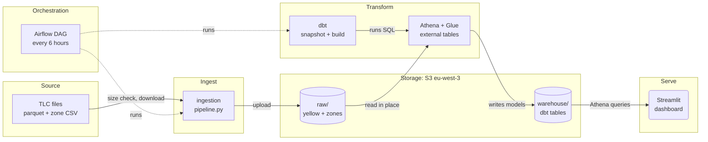
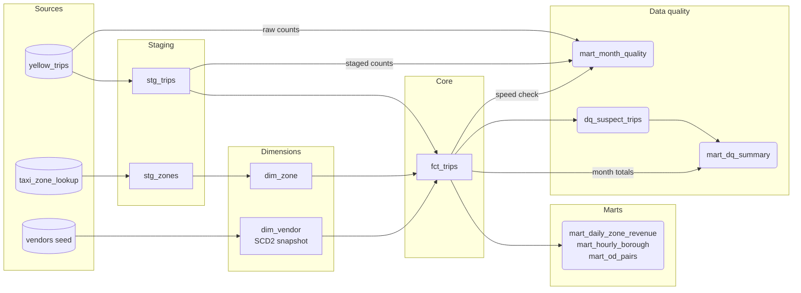
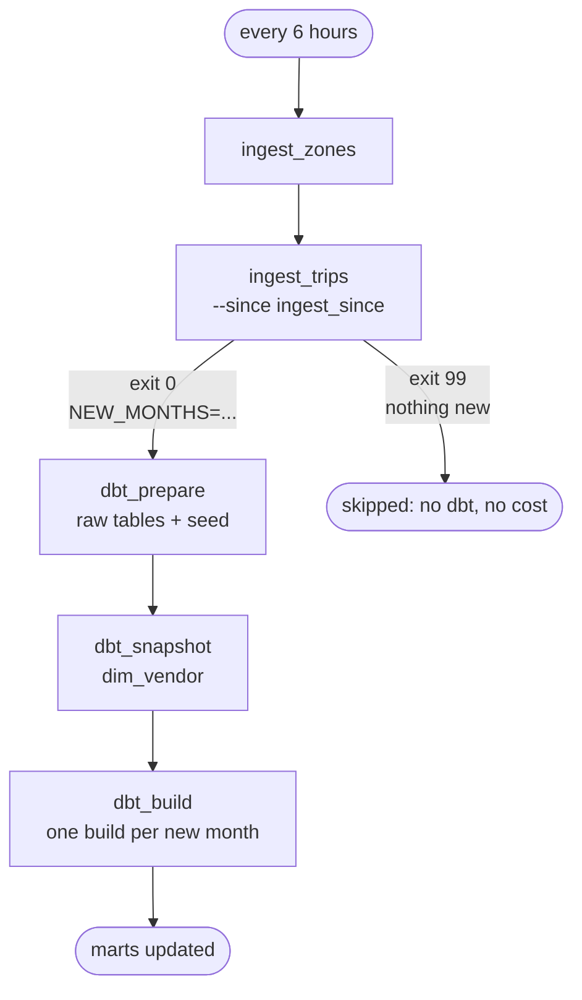

# Architecture

This page follows the data from the TLC website to the dashboard. Each section
explains the terms it introduces. For the dbt models themselves, see
[data-model.md](data-model.md).

## Overview

Solid arrows show data. Dashed arrows show Airflow starting a step.

| Layer | Tool |
|---|---|
| Source | TLC public files on CloudFront (`d37ci6vzurychx.cloudfront.net`) |
| Ingestion | Python 3.12, requests, boto3, pyarrow, tenacity |
| Storage | S3, region `eu-west-3` |
| Query | Athena over Glue external tables |
| Transform | dbt-core 1.12.6, dbt-athena 1.11.1 |
| Orchestration | Airflow 2.10.5, LocalExecutor, Postgres 16.4 |
| Dashboard | Streamlit 1.66.1 |
| CI | GitHub Actions |

## 1. Source

TLC publishes one parquet file per month and per service. This project loads
the yellow service only. The URL pattern is
`https://d37ci6vzurychx.cloudfront.net/trip-data/yellow_tripdata_YYYY-MM.parquet`.
A second file, `misc/taxi_zone_lookup.csv`, maps zone IDs to borough and zone
names. TLC publishes a month about two months after it ends. A month that is
not published yet answers HTTP 403.

## 2. Ingestion

`ingestion/pipeline.py` copies files from TLC to S3. For each month it does this:

1. Read the size of the S3 object (`head_object`) and the size TLC reports (an HTTP HEAD request).
2. If the sizes match, print `skipped` and stop. If TLC's size cannot be read but the S3 object exists, it also skips.
3. Otherwise stream the file to a temporary directory. The download refuses redirects, stops above 2 GiB (`MAX_DOWNLOAD_BYTES`), and fails when the byte count differs from `Content-Length`.
4. Check the parquet footer for the 10 required columns. No row data is read. For the zone CSV, check that the header is exactly `LocationID,Borough,Zone,service_zone`.
5. Upload to S3 and print `uploaded`.

HTTP and S3 calls retry up to 5 times with exponential backoff. A file only
reaches its final S3 key after a full, validated download.

The loader has two ways to choose months. `--months 2024-01 2024-02` loads the
months you name. `--since 2024-01` is discovery: it checks every month from
that month through the current UTC month. `--until YYYY-MM` ends the range
early, and `--dry-run` only reports what would happen.

Exit codes matter to Airflow. With `--skip-unpublished`, a 403 or 404 prints
`unpublished <url>` on stderr and the loader moves on. The last line on stdout is
`NEW_MONTHS=<months uploaded, oldest first>`. The exit code is 0 when at least
one month was uploaded and 99 when none was. Airflow turns 99 into a skipped
task instead of a failure.

## 3. Storage

One S3 bucket (default `merouane-nyc-taxi-raw-euw3-2026`) holds everything:

| Prefix | Content |
|---|---|
| `raw/yellow/year=YYYY/month=MM/yellow_tripdata_YYYY-MM.parquet` | Raw trip files |
| `raw/zones/taxi_zone_lookup.csv` | Raw zone lookup |
| `warehouse/` | Tables that dbt writes |
| `athena-results/` | Athena query output |

The `year=YYYY/month=MM/` folders are S3 partitions: folder names that Athena
reads as column values, so a query for one month reads one folder.

## 4. Glue and Athena

Athena runs SQL directly on files in S3 and bills by bytes scanned. Glue is
AWS's metadata catalog. It stores the table definitions Athena needs. An
external table is a definition that points at files in S3 without copying them.

The dbt macro `create_raw_tables` creates the Glue database `nyc_taxi_raw` with
two external tables:

- `yellow_trips`: parquet, partitioned by `year` and `month`, using partition projection. Projection tells Athena the partition values (years 2009 to 2030, months 1 to 12) instead of listing folders, so no partition registration is needed when a new month lands.
- `taxi_zone_lookup`: CSV, header row skipped.

The macro uses `create ... if not exists`, so you can run it any number of times.

## 5. dbt

dbt runs the SQL models in the order their `ref()` calls imply. The adapter is
dbt-athena. Output goes to the schema `nyc_taxi_dbt`, with data under
`s3://<bucket>/warehouse/`.

| Path | How dbt builds it |
|---|---|
| `models/staging` | Views. They store no data. |
| `models/marts` | Hive tables in parquet. |
| `snapshots/dim_vendor` | Iceberg table. dbt-athena snapshots need Iceberg because they use MERGE. |
| `seeds` | Hive table from `vendors.csv`. |

Four marts are incremental: `fct_trips`, `mart_hourly_borough`, `mart_od_pairs`
and `dq_suspect_trips`. The other marts are plain tables that dbt rebuilds on
every run (see [data-model.md](data-model.md)). An incremental model keeps its
table between runs and writes only what you ask for.
These models use the `insert_overwrite` strategy and are partitioned by
`pickup_month` (for example `2024-02`). With the variable `run_month`, dbt
rewrites that one partition. The month's rows replace the old ones, so a
re-run gives the same result. Without `run_month`, dbt rewrites every partition
in range. `--full-refresh` drops and rebuilds the table.

Two variables bound cost. `min_year` and `max_year` limit which raw partitions
staging reads. dbt also runs in the Athena workgroup `nyc-taxi-dbt`, which fails
any query that scans more than 5 GiB. `dbt/scripts/create_workgroup.py` creates
it ([ADR 0007](adr/0007-incremental-fct-trips-and-workgroup-cap.md)).

### Lineage

Read it left to right: raw sources, cleaned staging, dimensions, then
`fct_trips`, which holds one row per trip. Everything on the right is built from
`fct_trips`, except `mart_month_quality`, which also reads the raw table and
staging so it can compare row counts before and after cleaning. In the DAG, the
build selection does not include the snapshot. The `dbt_snapshot` task runs it
first.

## 6. Orchestration

Airflow is the scheduler. The DAG `nyc_taxi_elt` runs on `0 */6 * * *` (every 6
hours), with `catchup=False` and `max_active_runs=1`, so runs never overlap and
missed runs are not replayed. Each task is a `BashOperator` that runs from
`/opt/project`. Python and dbt live in a separate virtualenv (`/opt/venv`) so
their dependencies do not clash with Airflow's. Tasks retry 3 times with
exponential backoff, starting at 5 minutes.

Most runs take the exit 99 path. `ingest_trips` finds every month already in S3
or not yet published, exits 99, and Airflow marks it and the three dbt tasks
skipped. The run then costs only the size checks. When a month was uploaded,
the tasks run in order. `dbt_build` reads the `NEW_MONTHS` line that
`ingest_trips` pushed to XCom (Airflow's small message store between tasks).

What each task does:

- `ingest_zones` runs `ingestion.pipeline --zones`.
- `ingest_trips` runs `ingestion.pipeline --since <ingest_since> --service yellow --skip-unpublished`, plus `--until <ingest_until>` when that param is set.
- `dbt_prepare` runs `dbt run-operation create_raw_tables` and `dbt seed`. Both are safe to repeat.
- `dbt_snapshot` runs `dbt snapshot`. It sets `min_year` to the year of `ingest_since` and `max_year` to the year of the run.
- `dbt_build` loops over the new months, oldest first. For each it runs `dbt build --select stg_zones+ stg_trips+` with `run_month` set to that month. Here too, `min_year` is the year of `ingest_since` and `max_year` is the run's year, so `mart_month_quality` keeps every month. The `+` selects the model and everything downstream of it, tests included. If one month fails, the loop stops, the task fails, and the retry repeats every month. The builds are safe to repeat.

Two DAG params control the range. `ingest_since` (`YYYY-MM`, default
`2024-01`) is the first month checked and must not be after the run month.
`ingest_until` (`YYYY-MM`, default empty meaning the current month) is the
last month checked and must not be before `ingest_since`. The DAG validates both
when it renders the command and fails the task on a bad value. Each run
checks every month from `ingest_since`, so the cost of an idle run grows by two
cheap requests per month ([ADR 0009](adr/0009-full-discovery.md),
[ADR 0010](adr/0010-six-hourly-discovery.md)).

## 7. Serving

The Streamlit app (`app/main.py`) queries the marts through Athena in the same
workgroup. Every user value is validated and passed as an Athena query parameter.
Every query has a `limit`. Views that read monthly tables filter on the
`pickup_month` partition, and the heatmap on the Overview view reads `fct_trips`
with both a `pickup_month` range and an exact date range. Errors reach the user
as generic messages.

Results are cached for an hour. `app/freshness.py` guards against stale data: it
reads the newest `built_at` and latest month from `mart_month_quality` (a query
that scans almost nothing) at most every 20 seconds. The sidebar re-checks every
60 seconds. A change clears the cache and reruns the page.

## 8. CI

Two GitHub workflows, both described in
[ADR 0006](adr/0006-ci-without-aws-secrets.md).

- `ci.yml` runs on pull requests with no AWS credentials. Jobs: `lint-test` (ruff and pytest without the DAG tests), `dag-tests` (Airflow 2.10.5 with its constraint file) and `dbt-parse` (`dbt deps` and `dbt parse` only).
- `dbt-build.yml` runs the real `dbt build` on Athena. It triggers on pushes to `main` that touch `dbt/**` and on manual dispatch, never on pull requests. It gets AWS credentials from GitHub OIDC through the role in the repository variable `AWS_DBT_ROLE_ARN`, uses the `ci` target in `dbt/profiles.yml`, and builds 2024 only.

## 9. Local runtime

`docker-compose.yml` starts `postgres` (16.4), `airflow-init` (database
migration and admin user), `airflow-webserver` and `airflow-scheduler` with
`LocalExecutor`. The web UI binds to `127.0.0.1:8080`. Compose mounts `./dags`,
`./ingestion`, `./dbt` and `./pyproject.toml` read-only. It also mounts
`./.aws-airflow` (git-ignored, holds only the `nyc-taxi` profile) at
`/home/airflow/.aws`. The DAG is created paused. The Streamlit service in the
file is commented out.

## 10. Design notes

- `trip_id` is an md5 of vendor, pickup time, dropoff time, pickup zone, dropoff zone and total amount. Staging keeps one row per `trip_id`.
- `fct_trips` joins zones with a left join, so a trip with an unknown zone keeps a null borough and zone name.
- Staging drops rows instead of storing them. `mart_month_quality` counts what was dropped.
- Moving to another warehouse means rewriting Athena and Trino functions and the `table_type` and `format` settings ([ADR 0002](adr/0002-athena-dbt-over-snowflake.md)).
