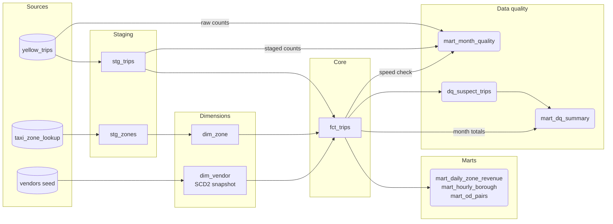
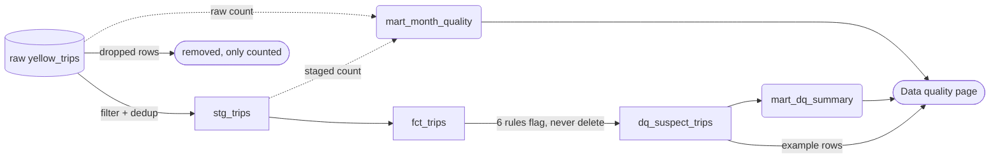

# Data model

This page describes every dbt model, the tests, and the rules that mark a trip
as suspect. The code is in `dbt/`. For how the models are scheduled and built,
see [architecture.md](architecture.md).

## Lineage

Cylinders are the raw sources, rectangles are models that other models use,
and rounded shapes are tables the dashboard reads. An arrow points from an
input to the model built from it. `fct_trips` is the hub: one row per trip,
joined to zones and vendors. The three marts and `dq_suspect_trips` are
summaries or filters of `fct_trips`, and `mart_dq_summary` summarizes
`dq_suspect_trips`. `mart_month_quality` has three inputs. It reads the raw
table and `stg_trips` to compare row counts before and after cleaning, and
`fct_trips` for the speed check.

## Models at a glance

| Model | Built as | Grain (one row per) |
|---|---|---|
| `stg_trips` | view | trip |
| `stg_zones` | view | taxi zone |
| `dim_zone` | table | taxi zone |
| `dim_vendor` | Iceberg snapshot | vendor and version of its name |
| `fct_trips` | incremental, by `pickup_month` | trip |
| `mart_daily_zone_revenue` | table | pickup zone and day |
| `mart_hourly_borough` | incremental, by `pickup_month` | day, hour, pickup borough, payment type and vendor |
| `mart_od_pairs` | incremental, by `pickup_month` | month, pickup zone and dropoff zone |
| `mart_month_quality` | table | month |
| `dq_suspect_trips` | incremental, by `pickup_month` | suspect trip |
| `mart_dq_summary` | table | month and primary reason code |

Staging models are views, so they store nothing. Marts are hive tables in
parquet. "Incremental, by `pickup_month`" means dbt keeps the table and rewrites
only the month you name with `run_month` (see
[architecture.md](architecture.md#5-dbt)).

## Staging

`stg_trips` reads the raw `yellow_trips` table for `min_year` to `max_year`
only. That `year` filter lets Athena skip other folders. The model renames
columns and casts types, then:

1. Builds `trip_id`, an md5 hash of vendor, pickup time, dropoff time, pickup zone, dropoff zone and total amount.
2. Drops rows that fail any of these checks: pickup time is null, dropoff is before pickup, the trip lasts 24 hours or more, distance is negative, total amount is negative, or the pickup falls outside the year and month of the file it came from (the files contain stray dates).
3. Keeps one row per `trip_id`. The window is partitioned by year, month and `trip_id`, and when rows tie it keeps the first by pickup time, total, passenger count, fare and distance.

Dropped rows are not stored. `mart_month_quality` counts them.

`stg_zones` reads `taxi_zone_lookup`, casts `LocationID` to an integer
`zone_id`, and drops rows with an empty ID.

## Dimensions

`dim_zone` is a copy of `stg_zones` with the columns `zone_id`, `borough`,
`zone_name` and `service_zone`.

`dim_vendor` is a snapshot of the `vendors` seed (`dbt/seeds/vendors.csv`:
vendor 1 Creative Mobile Technologies, 2 Curb Mobility, 6 Myle Technologies,
7 Helix). A snapshot keeps history: this is a slowly changing dimension of type
2 (SCD2). When a vendor's name changes, dbt closes the old row by setting
`dbt_valid_to` and adds a new row. The snapshot uses the `check` strategy on
`vendor_name`, because the seed has no updated-at column. dbt-athena
implements snapshots with MERGE, which Athena supports only on Iceberg tables,
so this one table is Iceberg ([ADR 0003](adr/0003-dbt-snapshot-scd2.md)).

History grows only when `dbt snapshot` runs. `fct_trips` joins the current row
(`dbt_valid_to is null`), so facts show today's vendor name, not the name at
trip time.

## Fact table

`fct_trips` has one row per trip. It joins `stg_trips` to `dim_zone` twice
(pickup and dropoff) and to the current `dim_vendor` row. Joins are left joins,
so an unknown zone gives a null name instead of dropping the trip. It adds:

- `pickup_date`, `pickup_hour` and `pickup_dow` (1 is Monday, 7 is Sunday).
- `trip_duration_min` and `avg_speed_mph`. Speed is null when the duration is zero.
- `payment_type_name`: 0 flex_fare, 1 credit_card, 2 cash, 3 no_charge, 4 dispute, 5 unknown, 6 voided.
- `tip_pct`: tip divided by fare, null when the fare is zero or less.
- `pickup_month` (`YYYY-MM`), the partition column.

## Marts

`mart_daily_zone_revenue` gives trips, total, fare and tip revenue, average
distance and average duration for each pickup zone and day. It feeds the
Overview and Airports views and the borough and date filters.

`mart_hourly_borough` groups by day, hour, weekday, pickup borough, payment type
and vendor. It stores sums (trips, revenue, distance, duration, passengers) so
the dashboard can recompute ratios for any filter. TLC records tips for card
payments only, so it also stores `card_fare_revenue` and `card_tip_revenue`. The
tip percentage is the card tips divided by the card fares. It feeds the Tips and
Efficiency views.

`mart_od_pairs` groups by month, pickup zone and dropoff zone (origin and
destination) with trips, revenue, distance and duration sums. It feeds the
Routes view.

## Data-quality tables

`mart_month_quality` has one row per month that has raw data. It holds raw
rows, staged rows, dropped rows and their percentage, and the number of trips
at 200 mph or more. It also counts raw rows by drop rule: negative total,
dropoff before pickup, 24 hours or more, and pickup outside the file's month.
These counts overlap, because one row can break several rules, so they can add
up to more than `dropped_rows`. Rows with a null pickup, a negative distance
or a duplicate `trip_id` are dropped too and appear only in `dropped_rows`.
The table also holds `negative_total_sum` and `passenger_missing_rows` (staged
rows with a null or zero passenger count, which are kept) and `built_at`, which
the dashboard uses to notice new builds.

Negative totals are refunds and adjustments, mostly in the dispute, cash and
no-charge payment types. They are not bad records. Staging drops them so they
stay out of revenue. For January and February 2024 they sum to about -$1.8
million.

`dq_suspect_trips` lists trips from `fct_trips` that match at least one rule
below. Trips stay in `fct_trips`. The table adds:

- `reason_code`, the first matching rule in the order of the table below.
- `reason_codes`, every matching rule, comma-separated.
- `suspect_field`, the field most likely to be wrong: `distance`, `timestamps`, `fare` or `both`.

`mart_dq_summary` has one row per month and primary `reason_code` with the
trip count, share of the month's trips, money on those trips and one example
`trip_id`. Each suspect trip counts once, under its primary code.

### Suspect-trip rules

The thresholds are dbt variables in `dbt/dbt_project.yml`. They are judgment
calls. Change them there. The table is in priority order.

| Reason code | A trip matches when | Variable | Likely wrong field |
|---|---|---|---|
| `DISTANCE_ABSURD` | distance is 100 miles or more | `dq_distance_absurd_miles` = 100 | distance |
| `SPEED_IMPLAUSIBLE` | average speed is 100 mph or more, and the trip is not already `DISTANCE_ABSURD` | `dq_speed_max_mph` = 100 | timestamps if the trip is under 60 seconds, otherwise distance |
| `TIMESTAMP_SUSPECT` | duration is under 60 seconds and distance is 1 mile or more | `dq_short_trip_seconds` = 60, `dq_short_trip_min_miles` = 1 | timestamps |
| `ZERO_DISTANCE_PAID` | distance is 0 and the total is $10 or more | `dq_zero_distance_min_fare` = 10 | distance |
| `LONG_DURATION` | duration is 720 minutes (12 hours) or more | `dq_long_trip_minutes` = 720 | timestamps |
| `ZERO_TOTAL` | total amount is exactly 0 | none | fare |

Staging already drops trips of 24 hours or more, so `LONG_DURATION` covers 12 to
24 hours. `suspect_field` is `both` when one trip matches a distance rule and a
timestamp rule.

Suspect trips stay in every dashboard number. The Data quality view explains each
code and suggests keeping suspect trips in revenue but leaving them out of speed
and efficiency figures. Nothing applies that suggestion yet.

The dashboard's own wording for `TIMESTAMP_SUSPECT` is inaccurate. It says the
dropoff is at or before the pickup, but staging already drops those rows. The real
rule is a duration under 60 seconds with a distance of at least 1 mile.

### How rows flow through the quality checks

A trip takes one of two paths. Staging removes it (the "removed" box), and only
a count remains. Or it is kept: it enters `fct_trips`, and if a rule matches, it
is also flagged in `dq_suspect_trips` with a reason. It never leaves `fct_trips`. The dashed lines show the counts that
`mart_month_quality` keeps so you can compare raw rows with staged rows. The
Data quality page reads all three quality tables.

## Tests

dbt runs the tests inside `dbt build`, after the model they check. A failed
test stops the models that depend on it.

Column tests (from the `.yml` files in `dbt/models`):

| Model | Column | Test |
|---|---|---|
| `stg_zones` | `zone_id` | not null, unique |
| `stg_trips` | `trip_id` | not null, unique |
| `stg_trips` | `vendor_id` | not null, one of 1, 2, 6, 7 |
| `stg_trips` | `payment_type` | one of 0 to 6 |
| `stg_trips` | `pickup_at` | not null |
| `dim_vendor` | `vendor_id`, `vendor_name` | not null |
| `dim_zone` | `zone_id` | not null, unique |
| `fct_trips` | `trip_id` | not null, unique |
| `fct_trips` | `vendor_id` | not null, exists in `dim_vendor` |
| `fct_trips` | `pickup_zone_id` | not null, exists in `dim_zone` |
| `fct_trips` | `dropoff_zone_id` | exists in `dim_zone` |
| `fct_trips` | `payment_type` | one of 0 to 6 |
| `fct_trips` | `trip_duration_min` | not null |
| `mart_daily_zone_revenue` | `pickup_date` | not null |
| `mart_hourly_borough` | `row_key` | not null, unique |
| `mart_hourly_borough` | `pickup_month`, `pickup_date`, `pickup_hour`, `trips` | not null |
| `mart_hourly_borough` | `payment_type_name` | one of the seven payment names |
| `mart_od_pairs` | `row_key` | not null, unique |
| `mart_od_pairs` | `pickup_month`, `trips` | not null |
| `mart_od_pairs` | `pickup_zone_id` | not null, exists in `dim_zone` |
| `mart_od_pairs` | `dropoff_zone_id` | exists in `dim_zone` |
| `mart_month_quality` | `month` | not null, unique |
| `mart_month_quality` | `raw_rows` | not null |
| `dq_suspect_trips` | `trip_id` | not null, unique |
| `dq_suspect_trips` | `pickup_month` | not null |
| `dq_suspect_trips` | `reason_code` | not null, one of the six codes |
| `dq_suspect_trips` | `suspect_field` | not null, one of distance, timestamps, fare, both |
| `mart_dq_summary` | `reason_code` | not null, one of the six codes |

Singular tests (SQL files in `dbt/tests`; each returns the bad rows and passes
when it returns none):

| Test | What it checks |
|---|---|
| `assert_dropoff_after_pickup` | No `fct_trips` row has a negative duration. Staging already drops these rows, so this guards the derived column. |
| `assert_plausible_speed` | Reports trips at 200 mph or more. Severity is `warn`, so it never blocks a build. |
| `assert_hourly_borough_reconciles` | Per month, `mart_hourly_borough` trips add up to the row count of `fct_trips`. |
| `assert_od_pairs_reconciles` | The same check for `mart_od_pairs`. |
| `assert_dq_summary_reconciles` | Per month, the trips in `mart_dq_summary` equal the distinct trips in `dq_suspect_trips`. |
| `assert_dq_suspects_in_fct` | Every `dq_suspect_trips` row exists in `fct_trips` for the same month. |

Outside dbt, the Python tests live in `tests/ingestion`, `tests/app` and
`tests/dags`. The ingestion step also checks the 10 required columns in each
downloaded file before upload.
